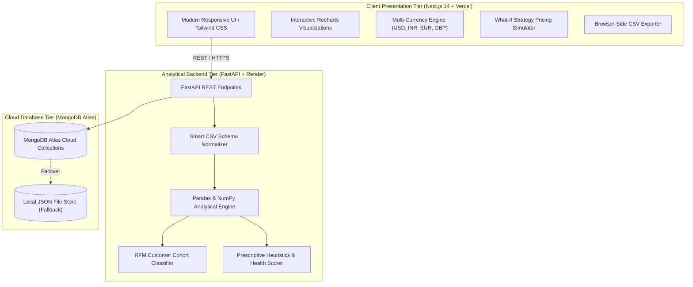

# Retail Insights — Enterprise Retail Analytics & BI Platform

[](https://frontend-m5va.vercel.app)
[](https://retail-insights-backend.onrender.com)
[](https://www.mongodb.com/atlas)
[](https://nextjs.org/)
[](https://fastapi.tiangolo.com/)
[](https://www.python.org/)

**Retail Insights** is an enterprise-grade Retail Analytics and Business Intelligence (BI) platform engineered by **Nikhil Kumar Nayak**. It empowers retail decision-makers across multi-category domains (Consumer Electronics, Fashion & Apparel, Supermarket Grocery) to ingest POS transaction data, analyze customer lifetime value (CLV & RFM), discover catalog margins, simulate pricing strategies, and act on automated business recommendations.

---

## 🏛️ System Architecture



---

## 🚀 Key Modules & Capabilities

### 1. ⚡ 1-Click Retail Domain Switcher
- Instantly switch between pre-loaded, production-quality retail transaction datasets directly from the Overview dashboard:
  - **⚡ Consumer Electronics Megastore** (179 transactions, high-ticket computing & audio)
  - **👗 Clothing Boutique** (160 transactions, seasonal apparel, footwear & accessories)
  - **🛒 Supermarket Grocery** (185 transactions, high-frequency essentials & perishables)

### 2. 📈 Sales & Revenue Intelligence
- Real-time **Net Revenue**, **Gross Profit**, **Average Order Value (AOV)**, and **Transaction Volume**.
- Time-series Revenue & Profit curve with **Daily vs. Cumulative** trend toggling.
- Weekly Day-of-the-Week revenue cycle analysis (identifying peak trading days).
- 24-hour peak shopping traffic distributions and payment tender breakdowns.

### 3. 📦 Products & Inventory Intelligence (with CSV Export)
- SKU Catalog KPIs: Breadth, active departments, weighted average price point, merchandise margin %.
- Top Best-Sellers ranked dynamically by **Revenue**, **Units Sold**, or **Gross Profit**.
- Price point sensitivity tiers formatted dynamically in the user's preferred currency ($ / ₹ / € / £).
- **Dead Stock & Slow Movers Velocity Alert** highlighting items at risk of stagnation.
- **One-Click CSV Export**: Download complete SKU unit economics and revenue share directory.

### 4. 👥 Customers & Retention Analytics (RFM Segmentation)
- Customer acquisition & repeat rate tracking with **Average Customer Lifetime Value (CLV)**.
- **Multi-Cohort RFM Segmentation** (Champions, Loyal Customers, Potential Loyalists, Big Spenders, At Risk, Hibernating) with distinct semantic color assignments.
- VIP Customer Leaderboard and demographic breakdowns (Gender & Age Groups).
- **One-Click CSV Export**: Export customer cohort revenue matrices directly to spreadsheet format.

### 5. 💡 Automated Prescriptive Insights & "What-If" Simulator
- **Retail Health Score (0–100)** with letter grades and 4 performance pillars.
- Rule-based heuristics detecting margin leakage, stock stagnation, and customer attrition.
- **Interactive "What-If" Pricing & Margin Simulator**:
  - Live scenario modeling for unit price adjustments (-15% to +25%) and discount containment (0% to 10%).
  - Configurable price elasticity sensitivity (Inelastic, Moderate, High Elastic).
  - Real-time projected cash flow, gross profit delta, and margin uplift calculations.

### 6. 💱 Real-Time Multi-Currency Engine
- Seamlessly toggle between **USD ($)**, **Indian Rupee (₹)**, **Euro (€)**, and **British Pound (£)**.
- Full support for regional formatting (e.g. Western Millions `$1.2M` vs. Indian Crores/Lakhs `₹1.2Cr`).
- Built-in FX calculator modal for fast conversions.

---

## 🛠️ Technology Stack

| Layer | Technology | Purpose |
|---|---|---|
| **Frontend** | Next.js 14 (App Router) | High-performance React framework with server/client optimization |
| **Language** | TypeScript & Python 3.11+ | End-to-end type safety and analytical computing |
| **Styling** | Tailwind CSS & Lucide Icons | Responsive modern enterprise dashboard styling |
| **Charts** | Recharts (v2.15) | Hardware-accelerated SVG interactive data visualizations |
| **Backend API** | FastAPI & Uvicorn | High-throughput asynchronous REST API microservice |
| **Data Engine** | Pandas & NumPy | High-speed tabular transformations and RFM cohort aggregation |
| **Database** | MongoDB Atlas Cloud | Scalable cloud document persistence with automated local JSON fallback |
| **Cloud Hosting**| Vercel & Render | Continuous global deployment from GitHub `main` branch |

---

## 💻 Local Setup & Execution

### Prerequisites
- Node.js 18+ & npm
- Python 3.10+

### Option A: 1-Click Launchers (Windows)
Double-click `run_all.bat` in the repository root to launch both the FastAPI backend and Next.js frontend concurrently.

### Option B: Manual Command Line
```powershell
# 1. Start Python FastAPI Backend (Port 8000)
cd backend
python -m venv venv
.\venv\Scripts\activate
pip install -r requirements.txt
uvicorn app.main:app --reload --port 8000

# 2. In a second terminal, start Next.js Frontend (Port 3000)
cd frontend
npm install
npm run dev
```

Open [http://localhost:3000](http://localhost:3000) in your browser. API documentation is available at [http://localhost:8000/docs](http://localhost:8000/docs).

---

## 👨‍💻 Author & Lead Architect

**Nikhil Kumar Nayak**
- GitHub: [@nikhilkumarnayak364-lang](https://github.com/nikhilkumarnayak364-lang)
- Project Repository: [retail-insights](https://github.com/nikhilkumarnayak364-lang/retail-insights)

---

## 📄 License
This project is licensed under the MIT License — see the LICENSE file for details.
