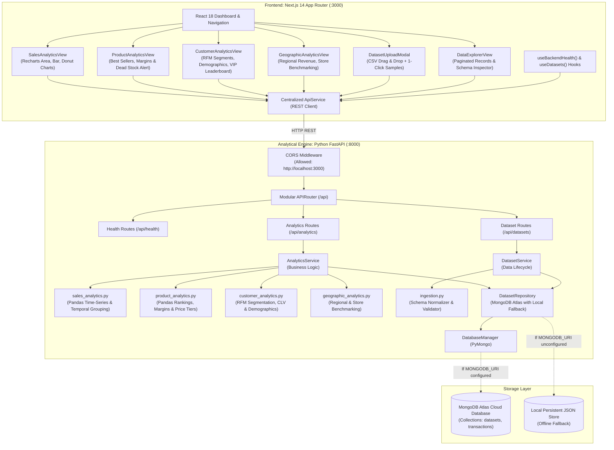

# Architecture & System Design — Retail Insights

## 1. Executive Summary

**Retail Insights** is an enterprise-grade Retail Analytics and Business Intelligence web platform designed to ingest multi-source retail datasets (e.g. clothing, electronics, grocery, and general retail), compute business-critical metrics, and provide interactive visualizations and prescriptive recommendations.

This document details the system design, covering **Phase 1 (Foundation)**, **Phase 2 (Data Ingestion & Storage)**, **Phase 3 (Sales & Product Analytics)**, **Phase 4 (Customer, Category, Geographic & Payment Analytics)**, and **Phase 5 (Automated Business Insights & Production Platform)**.

---

## 2. High-Level Architecture Diagram

---

## 3. Strict Boundary Isolation

### 3.1 Python as the Sole Analytical Engine
- **No Node.js Backend**: Node.js is exclusively utilized as the local runtime for Next.js tooling and frontend client rendering.
- **Python Exclusive Business Logic**: All data parsing, aggregation, summary statistics, cohort segmentation, and calculations are strictly executed via Python 3.13, Pandas, NumPy, and PyMongo.
- **No Direct Database Access from Frontend**: The frontend never communicates with MongoDB directly; all database queries and aggregations pass through authenticated FastAPI endpoints.

---

## 4. Phase 3 Analytics Engines

### 4.1 Sales Analytics Engine (`sales_analytics.py`)
Processes raw transaction records into time-series trajectories and temporal intelligence:
1. **Summary Financial KPIs**:
   - $\text{Gross Revenue} = \sum \text{total\_amount}$
   - $\text{Gross Profit} = \sum \text{profit}$
   - $\text{Profit Margin \%} = \frac{\text{Gross Profit}}{\text{Gross Revenue}} \times 100$
   - $\text{Average Order Value (AOV)} = \frac{\text{Gross Revenue}}{\text{Total Orders}}$
   - $\text{Average Basket Size} = \frac{\text{Total Units Sold}}{\text{Total Orders}}$
2. **Time-Series Trajectory**:
   - Groups by ISO date (`YYYY-MM-DD`) computing daily revenue, profit, unit volume, and cumulative revenue curve over the operating window.
3. **Weekly Temporal Cycles**:
   - Groups transactions by Day of the Week (`Monday` through `Sunday`), computing revenue distribution, transaction count, average ticket size, and identifying the business's peak trading weekday.
4. **Hourly Shopping Traffic**:
   - Aggregates transactions by hour of the day (`0:00` to `23:00`) to highlight peak retail footfall windows.
5. **Payment Tender Economics**:
   - Aggregates by `payment_method` (`Credit Card`, `Debit Card`, `Cash`, `Digital Wallet`, `BNPL`, `EBT`) computing revenue share % and average ticket size.
6. **Velocity & Momentum**:
   - Daily run rate ($\text{Revenue} / \text{Operating Days}$) and period-over-period growth %.

### 4.2 Product Analytics Engine (`product_analytics.py`)
Processes merchandise performance across catalog hierarchy and price sensitivities:
1. **Best-Seller Rankings**:
   - Top products ranked dynamically by **Revenue**, **Units Sold**, or **Gross Profit**.
   - Computes product-level profit margins and revenue contribution share:
     $$\text{Revenue Share \%} = \frac{\text{Product Revenue}}{\text{Catalog Revenue}} \times 100$$
2. **Category / Department Hierarchy**:
   - Aggregates performance by product department (e.g. Apparel, Footwear, Fresh Produce, Consumer Tech) showing department margin health.
3. **Price Point Sensitivity Tiers**:
   - Groups products into price bands (`Under $25`, `$25-$50`, `$50-$100`, `$100-$250`, `$250+`) measuring transaction volume and revenue yield across customer spending tiers.
4. **Dead Stock & Slow Mover Alerts**:
   - Automatically identifies the lowest-velocity SKUs to alert store managers to dead inventory risks.

---

## 5. Phase 4 Analytics Engines

### 5.1 Customer Analytics Engine (`customer_analytics.py`)
Segments customers using **RFM (Recency, Frequency, Monetary)** analysis and computes lifetime value metrics:
1. **Customer Summary KPIs**:
   - Total customers, repeat customers (2+ orders), repeat rate %, average CLV, orders per customer.
2. **RFM Segmentation**:
   - Assigns each customer recency, frequency, and monetary quartile scores (1–4).
   - Maps composite RFM scores to business segments: **Champions**, **Loyal Customers**, **Potential Loyalists**, **Recent Customers**, **Promising**, **Need Attention**, **At Risk**, **Cannot Lose Them**, **Hibernating**, **Lost**.
   - Aggregates per segment: customer count, total revenue, average spend, average order frequency, revenue share %.
3. **Demographics** (when data columns available):
   - **Gender** — Revenue, transactions, and unique customer count by gender with share %.
   - **Age Groups** — Bins customers into age brackets (18–24, 25–34, 35–44, 45–54, 55–64, 65+) with revenue share %.
4. **VIP Leaderboard**:
   - Top N customers by total lifetime spend with segment assignment, order count, average basket value, profit contribution, recency (days since last purchase), and last active date.

### 5.2 Geographic Analytics Engine (`geographic_analytics.py`)
Benchmarks store performance across regions and cities:
1. **Geographic Summary KPIs**:
   - Total stores, regions, cities, top-performing region and store, average revenue per store.
2. **Regional Aggregation**:
   - Groups transactions by region computing revenue, profit, units sold, store count, city count, profit margin %, and revenue share %.
3. **Store Benchmarking**:
   - Computes a **Performance Index** for each store:
     $$\text{Performance Index} = \frac{\text{Store Revenue per Transaction}}{\text{Fleet Average Revenue per Transaction}} \times 100$$
   - Stores scoring **>110** are outperformers (green), **90–110** are at fleet average (neutral), and **<90** are underperformers (amber).
   - Includes per-store: revenue, profit, transaction count, customer count, AOV, profit margin %.
4. **City Rankings**:
   - Aggregates by city showing revenue, transaction volume, store count, and revenue share % — ranked by revenue.

### 5.3 Category Hierarchy Analytics Engine (`category_analytics.py`)
Analyzes multi-level department taxonomy and subcategory performance:
1. **Summary Category KPIs**:
   - Total categories, total subcategories, top revenue department, top margin department, average category margin %, and catalog diversity index (Herfindahl-Hirschman index).
2. **Category & Subcategory Breakdown**:
   - Aggregates by department: revenue, gross profit, units sold, transaction count, SKU diversity count, profit margin %, and revenue contribution share %.
   - Nested subcategory intelligence detailing granular product lines within parent categories.

### 5.4 Payment Tender Analytics Engine (`payment_analytics.py`)
Computes checkout economics, interchange fee estimations, and payment mix:
1. **Payment Summary KPIs**:
   - Dominant tender type & market share %, digital adoption rate vs cash share %, overall average basket size, and estimated total processing fees.
2. **Tender Performance Matrix**:
   - Aggregates by method (Credit Card, Debit Card, Cash, Digital Wallet, BNPL, etc.): revenue, transactions, units, revenue share %, average ticket, margin %, and estimated interchange fee.
3. **Day-of-Week Tender Split**:
   - Models digital vs cash checkout volumes across days of the week to reveal weekend vs weekday payment habits.

---

## 6. Phase 5: Automated Business Insights & Recommendations Engine

### 6.1 Prescriptive Analytics Engine (`insights_engine.py`)
Performs algorithmic diagnostics across transactions to generate prioritized operational actions:
1. **Business Health Score (0-100)**:
   - Evaluates 4 core retail pillars (25 points each):
     - **Profit Margin Health**: Scaled against 30% margin benchmark.
     - **Customer Retention**: Scaled against 25% repeat purchase rate benchmark.
     - **Catalog Velocity**: Scaled against < 15% slow-mover SKU benchmark.
     - **Store Network Balance**: Scaled against < 20% variance across locations.
   - Assigns letter grades (`A+`, `A`, `B`, `C`, `Needs Attention`) and synthesizes key operational strengths and urgent focus areas.
2. **Rule Heuristics & Anomaly Scanners**:
   - **Margin Leakage Scanner**: Identifies high-volume SKUs operating below a 20% gross margin threshold and models an 8% pricing/cost optimization uplift.
   - **Dead Stock & Stagnant Inventory**: Detects catalog SKUs with $\le 2$ sales and models a 65% capital recovery via promotional clearance.
   - **Retention Churn Warning**: Alerts when repeat rate falls below 30% and models a 12% revenue gain from automated reorder sequences.
   - **Store Basket Variance**: Flags retail outlets scoring $< 90$ on the performance index.
   - **Payment Interchange Fee Leakage**: Evaluates high credit card concentration and quantifies savings from digital/UPI incentives.
   - **Peak Trading Window Staffing**: Identifies dominant sales volume days and peak hours to optimize store labor and inventory staging.
